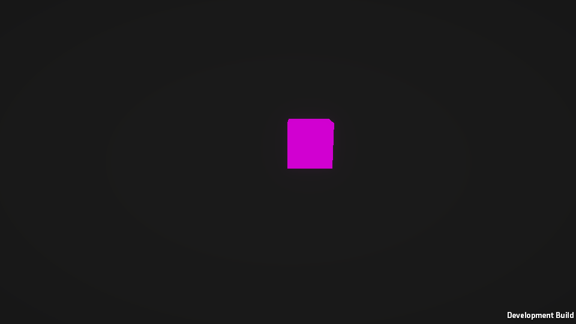

# AssetBundle · Addressables 실측 노트

블로그 시리즈(AssetBundle → Addressables → Content Directories)에 쓸 주장을 **Player에서 직접 재서** 확인한 결과입니다. 공식 문서에 없는 동작은 재기 전에는 결론을 쓰지 않는다는 원칙으로, 항목마다 문서 근거와 실측을 나눠 적었습니다.

| 항목 | 내용 |
|---|---|
| 에디터 | Unity `6000.6.3f1`, URP `17.6.0`, Addressables `4.1.1` |
| 빌드 타깃 | `StandaloneWindows64`, Development Build, Mono, 960×540 창 모드, 스플래시 끔(3차부터) |
| 렌더링 | PC 품질 단계, **GPU Resident Drawer 켜짐**(프로젝트 기본값). AB6·AB9·AD6은 끈 상태도 함께 측정 |
| 에셋 | [ContentDirectoriesStudy](https://github.com/SeoBYP/ContentDirectoriesStudy)와 같은 `Cube.prefab`(+`Rotator`) → URP `Lit.mat` → `Lit.shader`, `InDoor` 씬 |
| 측정 방식 | batchmode로 번들·Addressables·Player를 빌드하고, Player를 `-exp <ID>`로 실행해 `MeasureRunner`가 결과를 `Measure/results/<ID>.txt`에 남김 |
| 단위 | **KiB = 1,024 B, MiB = 1,024² B**. 결과 파일의 `KB`/`MB` 표기도 이 뜻입니다 |
| 표기 | **실측**: 이 프로젝트에서 측정 / **문서**: 공식 문서·가이드에 명시 / **소스**: 패키지 소스에서 확인 / **추정**: 근거로부터 추론 / **미실측** |

> **주의: Cube가 쓰는 `Lit.mat`은 `InDoor/Lit.mat`이 아닙니다.** `Cube.prefab`의 머티리얼 GUID `31321ba1…`은 URP 패키지의 `Runtime/Materials/Lit.mat`입니다. 처음에 `InDoor/Lit.mat`을 공용 번들에 넣었다가 중복이 사라지지 않아서 찾았습니다. 아래 결과는 모두 고친 뒤 다시 잰 값입니다.

### 측정 횟수
| 반복 측정 (중앙값) | 1회 측정 |
|---|---|
| AB2 (8라운드, 조건 순서 섞음), AB3 (5회), AB5 (3회), AD2 (3회) | AB1, AB4, AB6, AB7, AB8, AB9, AD1, AD3, AD4, AD5, AD6, AD7 |

1회 측정 항목의 숫자는 "이 정도 크기"로만 보고, 결론은 동작(남는다/내려간다/고쳐진다)에만 기대세요.

---

## 요약

| # | 질문 | 결과 (실측) |
|---|---|---|
| AB1 | 아무도 참조하지 않는 Resources 에셋도 빌드에 들어가나 | **들어감**. `resources.assets`에 포함, `Resources.Load` 성공. Resources 밖 미참조 에셋은 빠짐 |
| AB2 | Resources 에셋 0 / 1,000 / 10,000개일 때 첫 프레임 | **차이 없음**. 스플래시를 끄고 순서를 섞어 8라운드: 438.5 / 436.5 / 430.5 ms (작은 TextAsset 기준) |
| AB3 | LZMA / LZ4 / 무압축 크기·여는 시간·메모리 | LZMA는 작지만(8,386.5 KiB) 열 때 **276.6 ms, native +13.31 MiB**(전체를 메모리에 풂). LZ4·무압축은 0.8~0.9 ms, +1.0~1.3 MiB |
| AB4 | `LoadFromMemory`는 바이트 배열과 번들을 둘 다 들고 있나 | **둘 다 들고 있음**(Unity 가이드에 명시된 내용과 일치). 배열(gc +11.38 MiB)과 별개로 native +12.82 MiB |
| AB5 | `UnityWebRequest` 버전 유무별 로드·RAM | LZMA 기준 버전 없음 native **+14.49 MiB** / 버전 있음 **+2.18~2.47 MiB**(약 1/5~1/7, 3회). 캐시 재로드 2.7~3.1 ms |
| AB6 | 의존 번들 없이 `Instantiate`한 뒤 의존 번들을 열면 고쳐지나 | **고쳐짐**. 마젠타였던 기존 인스턴스가 `mat` 번들을 열자 같은 머티리얼로 그려짐 (GRD 켜짐·꺼짐 동일) |
| AB7 | 공용 머티리얼이 번들마다 복사되고 메모리에 두 벌이 되나 | **두 벌**. 머티리얼·셰이더 각 2개, 번들 265.6 KiB씩. 공용 번들로 빼면 1개, 프리팹 번들 3.9 KiB |
| AB8 | `Unload(false)` 뒤 재로드하면 옛 객체와 새 객체가 공존하나 | **공존**. 같은 `Lit`이 ID가 다른 2개, 셰이더도 2개 |
| AB9 | 사용 중 `Unload(true)` / `UnloadUnusedAssets` 비용 | 머티리얼이 파괴되어 **GRD 켜짐: 큐브가 사라짐 / GRD 꺼짐: 마젠타**. 경고·에러 로그 없음. UUA는 1~1,000개 1.6~2.5 ms로 같고, 1만 개부터 늘어 5만 개 22~36 ms |
| AD1 | Use Asset Database에서는 되는데 Player에서 깨지는 경우 | `Include in Build` 끈 그룹: 에디터 **성공**, Player **`InvalidKeyException`**. Use Existing Build 모드는 Player와 같이 실패 |
| AD2 | Pack Together / Separately / By Label | 번들 1 / 20 / 4개, 카탈로그 8.7 / 16.4 / 9.8 KiB, 에셋 하나 로드 49.6 / 16.0 / 22.6 ms |
| AD3 | Analyze가 중복을 잡고, 고치면 한 벌이 되나 | **잡고, 한 벌이 됨**. 11건 → Fix 후 "No issues found" 1줄, 머티리얼 2개 → 1개, native +7.18 → +5.82 MiB |
| AD4 | 같은 번들의 A만 Release하면 A가 남나 | **남음**. A 텍스처와 GPU 16 MiB가 B를 놓을 때까지 유지 |
| AD5 | 그 상태에서 `UnloadUnusedAssets`를 부르면 A가 내려가나 | **내려감**. GPU 16 MiB 반환, 번들은 열린 채 유지, 다시 로드하면 8.9 ms에 같은 ID로 복원 |
| AD6 | 핸들만 Release했을 때 `Object.Instantiate` vs `InstantiateAsync` | `Object.Instantiate`: 인스턴스는 **남고 머티리얼 null**(AB9와 같은 화면). `InstantiateAsync`: 인스턴스 **파괴**. `Destroy`만 하면 참조 카운트가 남아 **씬이 내려갈 때까지 번들이 열려 있음** |
| AD7 | 콘텐츠 업데이트 뒤 바뀐 번들만 받나 | **바뀐 번들만 받음**. 예측 189,734 B = 새 번들 파일 크기, 디스크 캐시 +189,757 B, 서버 요청도 새 번들 1개 + 카탈로그 |

Content Directories(CD1~CD4)는 [ContentDirectoriesStudy README 7.4절](https://github.com/SeoBYP/ContentDirectoriesStudy#74-블로그용-추가-측정-cd1cd4-배치-모드-자동-측정)에서 같은 조건으로 측정했습니다.

---

## AssetBundle

### AB1. 미참조 Resources 에셋도 빌드에 들어가나 → 들어감 (1회)
**문서**: Resources 폴더의 에셋은 참조 여부와 관계없이 빌드에 포함된다(매뉴얼 "Resources" 권고).

| 에셋 | 빌드 리포트 (`BuildReport.packedAssets`) | Player |
|---|---|---|
| `Assets/Resources/AB1_Unreferenced.txt` | `resources.assets` (64 B) | `Resources.Load` 성공 |
| `Assets/Measure/Unused/AB1_NotInResources.txt` | 없음 | - |

### AB2. Resources 에셋 수와 첫 프레임 → 이 조건에서는 차이 없음
같은 Player에 `Resources/item_NNNNN.txt`(각 약 20 B)만 늘려 3개를 빌드했습니다. 각 Player를 한 번씩 예열 실행한 뒤(결과에서 뺌), **8라운드 동안 라운드마다 세 Player의 실행 순서를 무작위로 섞어** 실행했습니다.

| Resources 에셋 | `resources.assets` | 첫 프레임 `realtimeSinceStartup` (중앙값, 범위) | 프로세스 시작 기준 (중앙값, 범위) |
|---|---|---|---|
| 3개 (기준) | 3.4 KiB | 438.5 ms (427~449) | 1,053.5 ms (1,030~1,082) |
| 1,003개 | 73.7 KiB | 436.5 ms (427~441) | 1,062.0 ms (1,041~1,087) |
| 10,003개 | 706.5 KiB | 430.5 ms (417~444) | 1,045.5 ms (1,036~1,071) |

- **스플래시 화면이 결과를 가리고 있었습니다.** 처음(2차) 측정은 스플래시가 켜져 있어 세 조건 모두 약 2,960 ms였고, 그중 약 2,500 ms가 스플래시였습니다. 스플래시를 끈 3차 측정이 위 표입니다.
- 스플래시를 꺼도 세 조건의 범위가 겹칩니다. **작은 TextAsset 1만 개로는 시작 시간 증가가 측정되지 않았습니다.**
- 매뉴얼의 "Resources가 많으면 시작이 느려진다"는 권고를 반박하는 결과는 아닙니다. 에셋 크기가 크거나 종류가 다르면 달라질 수 있고, 그 조건은 **미실측**입니다. 글에는 "개수만으로는 1만 개까지 차이가 안 보였다"까지만 쓸 수 있습니다.

### AB3. 압축 방식별 크기·여는 시간·메모리 (5회 중앙값)
2048×2048 Perlin 텍스처(임포트 결과 RGB24, 12 MiB) 번들, Cube 번들, InDoor 씬 번들. 압축마다 새 프로세스로 5번씩 실행했습니다. 메모리는 `LoadFromFile` 직후 `Profiler.GetTotalAllocatedMemoryLong` 증가분입니다.

| 번들 | 압축 | 파일 크기 | `LoadFromFile` | 연 직후 native | `LoadAsset` |
|---|---|---|---|---|---|
| payload | LZMA | 8,386.5 KiB (8.19 MiB) | **276.60 ms** | **+13.31 MiB** | 7.56 ms |
| payload | LZ4 | 11,651.2 KiB (11.38 MiB) | 0.82 ms | +1.29 MiB | 7.90 ms |
| payload | 무압축 | 12,292.7 KiB (12.00 MiB) | 0.90 ms | +1.04 MiB | 6.74 ms |
| cube | LZMA | 97.2 KiB | 4.48 ms | +0.61 MiB | 2.97 ms |
| cube | LZ4 | 265.6 KiB | 0.43 ms | +0.30 MiB | 3.35 ms |
| cube | 무압축 | 442.1 KiB | 0.46 ms | +0.13 MiB | 3.56 ms |
| scene | LZMA | 900.5 KiB | 36.57 ms | +2.58 MiB | - |
| scene | LZ4 | 1,930.7 KiB | 0.41 ms | +0.41 MiB | - |
| scene | 무압축 | 2,726.8 KiB | 0.54 ms | +0.21 MiB | - |

- **문서**("LZMA 번들을 `LoadFromFile`로 열면 전체를 메모리에 풀어 둔다")가 그대로 보입니다. payload LZMA는 열기만 해도 무압축 크기(12 MiB)만큼 native가 늘고, 여는 데 277 ms가 걸립니다.
- LZ4·무압축은 헤더만 읽어서 크기와 관계없이 1 ms 안쪽입니다. 실제 데이터는 `LoadAsset` 때 읽힙니다.

### AB4. `LoadFromMemory`는 둘 다 들고 있나 → 들고 있음 (1회)
**문서**: Unity Learn 가이드 [Assets, Resources and AssetBundles](https://learn.unity.com/tutorial/assets-resources-and-assetbundles)에 "이 API의 최대 메모리 사용량은 최소 번들 크기의 2배다(API가 만든 native 복사본 + 넘긴 관리 배열)"라고 적혀 있습니다. 6000.3 스크립트 레퍼런스의 `LoadFromMemoryAsync`도 "바이트 배열 내용을 복사해 메모리에 임시 번들 파일을 만든다"고 설명합니다. (처음 README에 "문서에 없음"이라고 쓴 것은 틀렸습니다.)

같은 payload 번들을 `File.ReadAllBytes` → `LoadFromMemory` 순서로 열었습니다.

| 단계 | LZMA (8.19 MiB) | LZ4 (11.38 MiB) | 무압축 (12.00 MiB) |
|---|---|---|---|
| ① `ReadAllBytes` | gc +8.20 | gc +11.38 | gc +12.01 |
| ② `LoadFromMemory` | **gc +8.20, native +13.31** (313.54 ms) | **gc +11.39, native +12.82** (11.64 ms) | **gc +12.02, native +13.31** (18.20 ms) |
| ③ 배열 `null` + GC | gc +0.02, native +14.07 | gc +0.02, native +13.45 | gc +0.02, native +13.94 |
| ④ `LoadAsset` | native +14.59, gfx +16.00 | native +13.48, gfx +16.00 | native +13.97, gfx +16.00 |
| ⑤ `Unload(true)` | native +2.31, gfx 0 | native +1.81, gfx 0 | native +1.69, gfx 0 |
| 비교: `LoadFromFile` 직후 | native +12.27 | native +0.26 | native +0.01 |

(단위 MiB, 기준선 대비)
- 가이드 설명대로 ② 시점에는 관리 배열과 native 복사본이 동시에 있어 번들 크기의 약 2배를 씁니다.
- 실측으로 덧붙일 수 있는 것: 배열을 놓고 GC하면 관리 쪽은 돌아가지만 native 복사본은 번들을 내릴 때까지 남습니다. LZ4·무압축이라도 `LoadFromFile`(+0.01~0.26 MiB)과 달리 번들 전체 크기를 상주시킵니다.

### AB5. `UnityWebRequestAssetBundle` 버전 유무 (3회 중앙값)
로컬 HTTP 서버(`python -m http.server`)에서 payload 번들을 받았습니다. `ver_first`는 `Caching.ClearCache()` 뒤 첫 실행, `ver_second`는 캐시가 찬 상태의 새 프로세스입니다. 한 프로세스에서 두 번씩 로드했습니다.

| 압축 | 경우 | 1회차 | 1회차 native | 2회차(같은 프로세스) | 디스크 캐시 |
|---|---|---|---|---|---|
| LZMA | 버전 없음 | 325.78 ms (매번 받음) | **+14.49** (14.38~14.62) | 303.72 ms, 다시 받음 | - |
| LZMA | 버전 있음, 캐시 비움 | 323.12 ms (받음) | **+2.47** (2.47~2.73) | **2.67 ms**, 0 B | 11.99 MiB |
| LZMA | 버전 있음, 캐시 있음 | **26.27 ms**, 0 B | +2.18 (2.06~2.18) | 3.09 ms | 11.99 MiB |
| LZ4 | 버전 없음 | 47.46 ms | +13.98 (13.83~14.22) | 36.71 ms, 다시 받음 | - |
| LZ4 | 버전 있음, 캐시 비움 | 31.31 ms | +2.19 (2.05~2.43) | 2.17 ms | 11.38 MiB |
| LZ4 | 버전 있음, 캐시 있음 | 25.31 ms | +2.18 | 2.49 ms | 11.38 MiB |

(native 단위 MiB)
- **문서**("버전을 주면 디스크 캐시를 쓰고 RAM이 크게 준다")는 확인됐습니다. 이 번들에서는 **약 1/5~1/7**(14.49 → 2.06~2.73 MiB)이었고, 문서의 "10배 이상"까지는 나오지 않았습니다. 비율은 번들 크기에 따라 달라집니다(추정).
- 버전이 없으면 같은 프로세스에서도 매번 다시 받습니다.
- LZMA를 캐시에 넣으면 11.99 MiB가 됐습니다. LZ4로 다시 썼다는 문서 내용과 맞지만, 이 텍스처는 LZ4로 거의 줄지 않아(LZ4 11.38 / 무압축 12.00 MiB) **크기만으로는 LZ4 재압축인지 무압축 저장인지 구분하지 못했습니다(미확인).**

### AB6. 의존 번들 없이 `Instantiate`한 뒤 의존 번들을 열면 → 고쳐짐 (1회, GRD 켜짐·꺼짐)
`shared_lz4`(cubea → mat 의존)에서 `cubea`만 열고 Cube를 만든 뒤 `mat`을 열었습니다. 문서에는 이 동작이 없습니다.

| 단계 | 기존 인스턴스 머티리얼 | 화면 중심 픽셀 (GRD 켜짐 / 꺼짐) |
|---|---|---|
| `cubea`만 열고 `Instantiate` | `sharedMaterial = null` | **rgb(209,0,209) 마젠타** / 마젠타 |
| `mat` 번들 열기 (2프레임 뒤) | **`Lit`** | rgb(140,133,129) 정상 / 정상 |
| 그 뒤 새 `Instantiate` | 같은 `Lit` | 정상 / 정상 |


- 끊어진 참조는 "없음"으로 굳지 않고, **의존 번들이 열리면 이미 만든 인스턴스도 같은 머티리얼을 가리키게 됩니다.** 프리팹을 다시 `LoadAsset`하면 같은 객체가 돌아옵니다(`True`).
- 그래도 의존 번들이 열리기 전 프레임에는 마젠타로 그려지므로, 의존 번들을 먼저 여는 순서가 필요합니다.

### AB7. 공용 머티리얼 중복 → 번들마다 복사, 메모리에 두 벌 (1회)
`Cube`와 `CubeB`(같은 URP `Lit.mat`)를 각자 번들로 만들었습니다.

| 구성 | cubea / cubeb 크기 | 의존성 | `Lit` 머티리얼 | `URP/Lit` 셰이더 | 같은 객체? | native 증가 |
|---|---|---|---|---|---|---|
| `dup` (머티리얼 미지정) | 265.6 / 265.6 KiB | 없음 | **2개** | **2개** | False | +7.70 MiB |
| `shared` (`mat` 번들 분리) | 3.9 / 4.0 KiB | `mat` | 1개 | 1개 | True | +5.56 MiB |

- **문서**(Avoid asset duplication)대로입니다. 번들 크기의 대부분은 머티리얼이 아니라 **함께 끌려온 `Lit.shader`** 입니다(`mat` 번들만 262.6 KiB).
- `GetAllAssetNames()`에는 명시한 프리팹만 나오고 암묵 포함된 머티리얼은 보이지 않습니다. 중복을 번들 API로는 알아채기 어렵습니다.

### AB8. `Unload(false)` 뒤 재로드 → 옛 객체와 새 객체 공존 (1회)
**문서**: [2017.4 매뉴얼](https://docs.unity3d.com/2017.4/Documentation/Manual/AssetBundles-Native.html)에 "`Unload(false)` 뒤 다시 로드하면 기존 사본에 다시 연결하지 않고 M의 사본이 두 개가 된다"고 적혀 있습니다. 최신 매뉴얼에는 "`Unload(true)`로 중복을 막아라"까지만 남아 있습니다.

| 단계 | `Lit` 머티리얼 | 비고 |
|---|---|---|
| 로드 + go1 생성 | 1 [2683] | |
| 두 번들 `Unload(false)` | 1 [2683] | 열린 번들 0개, go1은 정상 |
| 다시 열고 go2 생성 | **2 [2683, 2687]** | 셰이더도 2개, native +5.54 → +7.10 MiB |
| go1 파괴 + `UnloadUnusedAssets` | 1 [2687] | |

- 2017.4 매뉴얼 설명대로 **같은 에셋의 두 번째 사본**이 메모리에 공존했습니다.
- 정리는 옛 객체를 쓰는 곳을 없앤 뒤 `UnloadUnusedAssets`로만 됐습니다.

### AB9. 사용 중 `Unload(true)`, `UnloadUnusedAssets` 비용 (1회, GRD 켜짐·꺼짐)
| 단계 | 인스턴스 | GRD 켜짐 (기본값) | GRD 꺼짐 |
|---|---|---|---|
| 정상 | `Lit` | 큐브 보임 | 큐브 보임 |
| `mat` 번들 `Unload(true)` | `sharedMaterial = null`, 메모리의 `Lit` 0개 | **사라짐** (배경 rgb(26,26,26)) | **마젠타** rgb(209,0,209) |
| `cubea` 번들도 `Unload(true)` | GameObject 살아 있음, 메시 `Cube`(내장 리소스라 번들에 없음) | 계속 안 보임 | 계속 마젠타 |

| GRD 켜짐 | GRD 꺼짐 |
|---|---|
|  |  |

- 머티리얼이 파괴되면 렌더러의 머티리얼은 `null`이 되고, **그리는 방식은 GPU Resident Drawer 설정에 따라 다릅니다.** GRD를 끄면 기존 렌더 경로가 에러 셰이더(마젠타)로 그리고, GRD가 켜져 있으면 아예 그리지 않았습니다. GRD가 null 머티리얼 렌더러를 건너뛰는 것으로 보입니다(추정, 소스 미확인).
- 메시는 내장 `Cube`라 끝까지 살아 있었습니다. 화면에서 사라진 원인은 메시가 아니라 머티리얼입니다.
- 이 과정에서 **경고·에러 로그는 하나도 없었습니다.** 측정 코드가 `Application.logMessageReceived`로 Warning 이상을 모두 기록했고, Player.log에도 관련 경고가 없었습니다.

`Resources.UnloadUnusedAssets()` 호출부터 완료까지 (비활성 GameObject 수별, 3회, 빈 프레임 0.4~1.3 ms 포함, GRD 켜짐):

| 씬 GameObject | 1회 | 2회 | 3회 |
|---|---|---|---|
| 1 | 2.47 ms | 1.68 ms | 1.71 ms |
| 1,000 | 1.75 ms | 1.57 ms | 1.60 ms |
| 10,000 | 5.20 ms | 3.92 ms | 3.73 ms |
| 50,000 | 32.96 ms | 24.66 ms | 21.97 ms |

- 1개와 1,000개는 차이가 없고, **1만 개부터 늘기 시작해** 5만 개에서는 한 프레임 예산(16.7 ms)을 넘었습니다. GRD를 꺼도 같은 경향이었습니다(5만 개 25.7~35.6 ms).

---

## Addressables

모든 그룹은 기본값(LZ4, Can Change Post Release)입니다. Player 하나를 빌드해 두고 `StreamingAssets/aa` 폴더만 단계별 빌드 결과로 바꿔 끼워 실행했습니다.

### AD1. 에디터에서는 되는데 Player에서 깨지는 경우 (1회)
`AD1_Excluded` 그룹(`Include in Build` 끔)과 `AD1_Included` 그룹을 만들고, 에디터 Play Mode(Test Runner PlayMode 테스트)와 Player에서 같은 키를 로드했습니다.

| 실행 | `AD1/Included` | `AD1/Excluded` |
|---|---|---|
| 에디터, Use Asset Database | 성공 | **성공** |
| 에디터, Use Existing Build | 성공 | `InvalidKeyException: No Location found for Key=AD1/Excluded` |
| Player | 성공 | **`InvalidKeyException`** (같은 메시지) |
| Player, Addressables 콘텐츠 없이 빌드 | `InvalidKeyException` | `InvalidKeyException` |

- **소스** (Addressables 4.1.1): Use Asset Database 모드는 `Editor/Build/FastModeInitializationOperation.cs` 74행에서 `AddressableAssetSettingsLocator`를 등록합니다. 이 로케이터는 `Editor/Build/AddressableAssetSettingsLocator.cs`의 `RebuildInternalData()`(117~125행)에서 **모든 그룹의 모든 엔트리**를 키 테이블에 넣고, `IncludeInBuild`를 확인하지 않습니다. 그래서 에디터에서만 로드됩니다.
- 콘텐츠를 빌드하지 않은 Player는 초기화부터 실패합니다: `Invalid path in TextDataProvider : '…/StreamingAssets/aa/settings.json'`, `RuntimeData is null. Please ensure you have built the correct Player Content.` 이 프로젝트는 "Player 빌드 때 Addressables를 빌드하지 않음"(`DoNotBuildWithPlayer`)으로 설정했고, 콘텐츠 빌드를 빼먹으면 이렇게 됩니다.
- **Use Existing Build 모드는 Player와 같은 결과**를 냅니다. 출시 전 확인은 이 모드로 해야 합니다.

### AD2. 묶음 방식별 번들 수·카탈로그·로드 비용 (3회 중앙값)
512×512 텍스처 20개(라벨 `L0`~`L3` 5개씩), `AD2/Tex03` 하나를 로드했습니다.

| Bundle Mode | 번들 수 | 번들 크기 | 카탈로그 (`catalog.bin`) | 에셋 하나 로드 | 열린 번들 | 메모리에 올라온 텍스처 |
|---|---|---|---|---|---|---|
| Pack Together | 1 | 14,552.1 KiB | 8.7 KiB | **49.64 ms** | 1 | 1개 |
| Pack Separately | 20 | 714~737 KiB | **16.4 KiB** | **16.00 ms** | 1 | 1개 |
| Pack Together By Label | 4 | 3,622~3,654 KiB | 9.8 KiB | 22.59 ms | 1 | 1개 |

- 세 방식 모두 요청한 텍스처 1개만 메모리에 올라왔고(native +1.7~1.9 MiB, gfx +1.00 MiB), 번들이 클수록 로드 시간만 늘었습니다. 큰 LZ4 번들을 여는 비용이 커지는 것으로 보입니다(추정).
- 번들을 쪼갤수록 카탈로그가 커집니다(20개일 때 약 2배). Addressables 4.1.1의 기본 카탈로그는 바이너리(`catalog.bin`)입니다.

### AD3. Analyze가 AB7 같은 중복을 잡고, 고치면 한 벌이 되나 → 그렇다 (1회)
`AD3_A`, `AD3_B` 그룹에 같은 머티리얼(`AD3_Mat`)을 쓰는 프리팹을 하나씩 넣었습니다. 측정 스크립트는 `ad3_before` 단계에서 이전 실행이 만든 `Duplicate Asset Isolation` 그룹을 먼저 지우므로, 다시 돌려도 "고치기 전" 상태에서 시작합니다.

| | Analyze (`Check Duplicate Bundle Dependencies`) | 프리팹 번들 | 머티리얼 | 같은 객체? | native |
|---|---|---|---|---|---|
| 고치기 전 | **11건** (AD3_Mat, Lit.shader, FallbackError, FallbackShader × A/B, AD6의 셰이더 3건) | 264.5 / 264.4 KiB | **2개** | False | +7.18 MiB |
| Fix 후 | `analyze_result_count 1`, 그 1건은 **"No issues found"** (결과 파일에 기록) | 3.6 / 3.6 KiB + 격리 번들 262.9 KiB | **1개** | True | +5.82 MiB |

- Fix는 `Duplicate Asset Isolation` 그룹을 만들고 중복 4개(머티리얼과 셰이더 3개)를 옮깁니다. AB7을 손으로 고친 것과 같은 결과가 자동으로 나옵니다.
- 셰이더처럼 **패키지 에셋도 중복 대상**입니다. 실제 크기의 대부분은 머티리얼이 아니라 셰이더였습니다.

### AD4·AD5. 같은 번들의 A만 Release하면 (1회)
`AD4` 그룹(Pack Together)에 A(2048² 텍스처, GPU에 RGBA32로 16 MiB)와 B(64² 텍스처).

| 단계 | A | B | gfx | 열린 번들 |
|---|---|---|---|---|
| A, B 로드 | 있음 | 있음 | +16.02 MiB | 1 |
| **A Release** | **있음** | 있음 | **+16.02 MiB** | 1 |
| (AD5) `UnloadUnusedAssets` | **없음** | 있음 | **+0.02 MiB** | 1 |
| (AD5) A 다시 로드 | 있음, 8.93 ms, **같은 ID** | 있음 | | 1 |
| B Release | 없음 | 없음 | 0 | 0 |

- **AD4**: 문서("You can't unload part of an AssetBundle", 4.1.1 패키지 문서 `memory-assets.md`)대로, A는 참조 카운트가 0이어도 B가 번들을 잡고 있는 동안 메모리에 남습니다.
- **AD5 (메모리 페이지에 없는 내용)**: `Resources.UnloadUnusedAssets`는 번들이 열려 있어도 Release된 A를 내립니다. 번들은 열린 채라 다시 로드하면 번들에서 다시 읽어 옵니다(같은 인스턴스 ID).

### AD6. 핸들만 Release했을 때 인스턴스 차이 (1회, GRD 켜짐·꺼짐)
문서에는 이 차이가 명시되어 있지 않습니다. 처리 직후(3프레임), 2초 뒤, `UnloadUnusedAssets` 뒤, 씬(`SampleScene`)을 Single로 다시 로드한 뒤를 모두 확인했습니다.

| 방식 | 처리 | 인스턴스 | 머티리얼 | 열린 번들: 직후 → 2초 → UUA → 씬 재로드 | 화면 (GRD 켜짐 / 꺼짐) |
|---|---|---|---|---|---|
| `LoadAssetAsync` + `Object.Instantiate` | 로드 핸들 `Release` | **살아 있음**(씬 재로드 때 함께 파괴) | **null** | 0 → 0 → 0 → 0 | **사라짐 / 마젠타** |
| `InstantiateAsync` | 핸들 `Release` | **파괴됨** | - | 0 → 0 → 0 → 0 | - |
| `InstantiateAsync` | `Destroy(go)`만 | 파괴됨 | `Lit` 1개 남음 | **3 → 3 → 3 → 0** | - |
| `InstantiateAsync` | `ReleaseInstance(go)` | 파괴됨 | - | 0 → 0 → 0 → 0 | - |

- `Object.Instantiate`한 인스턴스는 Addressables가 모릅니다. 로드 핸들을 놓으면 번들이 내려가고 머티리얼이 파괴되어 **AB9와 같은 화면**(GRD 켜짐: 사라짐, 꺼짐: 마젠타)이 됩니다. 이때 경고·에러 로그는 없었습니다. Content Directories의 E1′과 같은 성질입니다.
- `InstantiateAsync`는 인스턴스 수명까지 Addressables가 관리합니다. 대신 **`Destroy`만 하면 핸들이 유효한 채로 남아 참조 카운트가 줄지 않고, 번들이 열린 채 유지됩니다.** 2초 뒤와 `UnloadUnusedAssets` 뒤에도 그대로였고, **씬을 다시 로드하자 내려갔습니다.** 즉 영구 누수가 아니라 "그 씬이 내려갈 때까지 유지"입니다. 문서의 "`trackHandle`이 켜진 `InstantiateAsync` 인스턴스는 자동으로 해제된다"(`UnloadingAddressableAssets.md`)는 씬 언로드 맥락이고, 측정도 그와 맞습니다.

### AD7. 콘텐츠 업데이트 뒤 바뀐 번들만 받나 → 그렇다 (1회)
원격 그룹 `AD7_Remote`(Pack Separately, 텍스처 2개, 라벨 `AD7`) + 원격 카탈로그, 로드 경로 `http://127.0.0.1:8765/ServerData/[BuildTarget]`. 1회차 실행 → `AD7_Item1.png`만 바꾸고 `ContentUpdateScript.BuildContentUpdate`(Update a Previous Build) → 2회차 실행.

| | 1회차 (캐시 비움) | 2회차 (업데이트 뒤) |
|---|---|---|
| `GetDownloadSizeAsync(Item0)` | 189,120 B | **0 B** |
| `GetDownloadSizeAsync(Item1)` | 189,303 B | **189,734 B** |
| 새 item1 번들 파일 크기 (빌드 결과) | - | 185.3 KiB (189,734 B) |
| 다운로드 전후 디스크 캐시 증가 | 378,469 B | **189,757 B** |
| 서버가 받은 요청 ([`AD7_http.log`](Measure/results/AD7_http.log)) | `catalog_0.1.0.hash` ×2, item0·item1 번들 | `catalog_0.1.0.hash` ×2, **`catalog_0.1.0.bin`**, **새 item1 번들만** |
| `CheckForCatalogUpdates` | `[]` | `[]` |

- `GetDownloadSizeAsync`와 `DownloadDependenciesAsync`의 합계는 둘 다 카탈로그에 적힌 번들 크기에서 나온 값이라 서로 독립된 증거가 아닙니다. 그래서 **카탈로그와 독립된 근거 두 가지**를 따로 남겼습니다. 디스크 캐시는 새 번들 크기만큼(+23 B, 캐시 정보 파일로 추정) 늘었고, 서버 로그에는 바뀐 번들 요청만 있습니다.
- 업데이트 빌드는 item1만 새 해시 이름(`…_9d2c9f0e….bundle`)으로 추가했고, item0 번들은 그대로 두었습니다.
- 2회차는 초기화 중에 원격 카탈로그 해시가 달라진 것을 보고 새 카탈로그를 자동으로 받았습니다. 그래서 그 뒤 `CheckForCatalogUpdates`는 빈 목록입니다. 이 프로젝트는 시작 시 카탈로그 자동 갱신이 켜진 기본값(`AddressableAssetSettings.asset`의 `m_DisableCatalogUpdateOnStart: 0`)입니다. `CheckForCatalogUpdates` → `UpdateCatalogs`를 직접 부르는 흐름은 이 설정을 끈 경우에 해당하며, 그 조건은 **미실측**입니다.

---

## 측정 조건과 한계

- 메모리는 `Profiler.GetTotalAllocatedMemoryLong`(native), `GC.GetTotalMemory`(gc), `Profiler.GetAllocatedMemoryForGraphicsDriver`(gfx)의 **기준선 대비 증가분**입니다. `Process.PrivateMemorySize64`는 이 Player에서 항상 0이 나와서 쓰지 않았습니다.
- 다른 Unity 에디터 두 개가 같은 PC에서 실행 중인 상태에서 쟀습니다. 시간 값은 같은 조건의 상대 비교로만 보세요.
- 파일은 반복 실행마다 OS 파일 캐시에 올라와 있습니다(콜드 디스크 읽기는 미실측).
- payload 텍스처는 알파가 없어 RGB24(12 MiB)로 임포트됐고, GPU에는 16 MiB(RGBA)로 올라갑니다.
- 스플래시는 3차 측정(AB2·AB5·AB6·AB9·AD3·AD6·AD7)부터 껐습니다. 나머지 항목은 스플래시가 켜진 Player로 쟀지만, 첫 프레임 이후에 측정하므로 결과에 영향이 없습니다.
- ContentDirectoriesStudy의 7.4절 Player는 Managed Stripping Level = High였고, 이 프로젝트는 기본값입니다. 스트리핑에 영향받는 항목은 없지만 Player 크기는 비교하지 마세요.
- `AD3_Mat`은 `InDoor/Lit.mat`을 복사해 만든 별도 머티리얼입니다(셰이더는 같은 URP Lit).

## 재현 방법

```bash
Measure/build_all.sh   # 에셋 생성, 번들, Addressables 단계별 빌드, Player
python -m http.server 8765 --bind 127.0.0.1 --directory Builds   # 다른 터미널 (AB5, AD7)
Measure/run_ab.sh      # AB1, AB3~AB8
Measure/run_ad.sh      # AD1~AD5
Measure/phase2.sh      # AD1 에디터 측정 (뒤쪽 AB6~AB9·AD7·AB2는 phase3에서 다시 잼)
Measure/phase3.sh      # 검수 반영 재측정: AB2, AB5, AB6, AB9, AD3, AD6, AD7
python Measure/summarize.py   # 반복 측정 중앙값
```

| 경로 | 내용 |
|---|---|
| `Assets/Measure/Editor/MeasureSetup.cs` | 측정용 에셋 생성, Addressables 그룹 구성 |
| `Assets/Measure/Editor/MeasureBuild.cs` | 번들·Player·AB2·Addressables 단계별 빌드 (`-executeMethod`) |
| `Assets/Measure/MeasureRunner.cs` | Player에서 `-exp`로 실행되는 측정 코드 |
| `Assets/Measure/Tests/AD1EditorPlayModeTest.cs` | AD1 에디터 Play Mode 측정 |
| `Measure/results/` | 원본 결과(`키<TAB>값`), 스크린샷, AD7 서버 로그 |

## 참고 문서
- [AssetBundles (Unload)](https://docs.unity3d.com/6000.3/Documentation/Manual/AssetBundles-Native.html), [2017.4 판](https://docs.unity3d.com/2017.4/Documentation/Manual/AssetBundles-Native.html)
- [AssetBundle compression and caching](https://docs.unity3d.com/ru/2020.2/Manual/AssetBundles-Cache.html)
- [AssetBundle.LoadFromMemoryAsync](https://docs.unity3d.com/6000.3/Documentation/ScriptReference/AssetBundle.LoadFromMemoryAsync.html), [Unity Learn: Assets, Resources and AssetBundles](https://learn.unity.com/tutorial/assets-resources-and-assetbundles)
- [Avoid asset duplication](https://docs.unity3d.com/6000.6/Documentation/Manual/assets-avoid-duplication.html)
- [Addressables Memory management](https://docs.unity3d.com/Packages/com.unity.addressables@2.3/manual/MemoryManagement.html), 4.1.1 패키지 문서 `memory-assets.md`, `UnloadingAddressableAssets.md`
- [Addressables 4.1 convert-content-directories](https://docs.unity3d.com/Packages/com.unity.addressables@4.1/manual/convert-content-directories.html)
- [ContentDirectoriesStudy](https://github.com/SeoBYP/ContentDirectoriesStudy)
