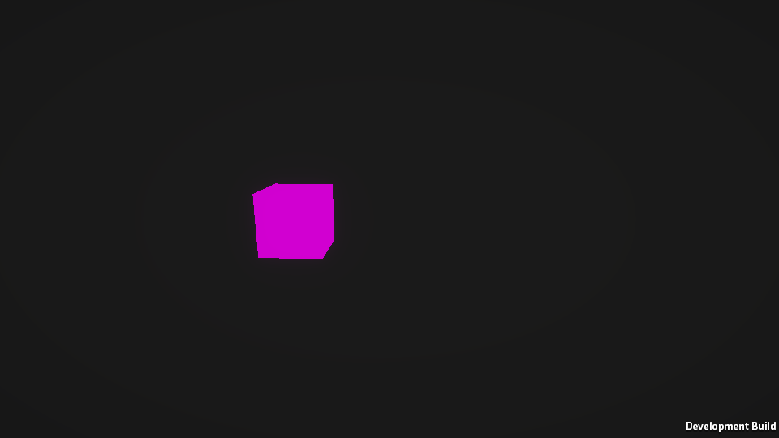

# AssetBundle · Addressables 실측 노트

블로그 시리즈(AssetBundle → Addressables → Content Directories)에 쓸 주장을 **Player에서 직접 재서** 확인한 결과입니다. 공식 문서에 없는 동작은 재기 전에는 결론을 쓰지 않는다는 원칙으로, 항목마다 문서 근거와 실측을 나눠 적었습니다.

| 항목 | 내용 |
|---|---|
| 에디터 | Unity `6000.6.3f1`, URP `17.6.0`, Addressables `4.1.1` |
| 빌드 타깃 | `StandaloneWindows64`, Development Build, Mono, 960×540 창 모드 |
| 에셋 | [ContentDirectoriesStudy](https://github.com/SeoBYP/ContentDirectoriesStudy)와 같은 `Cube.prefab`(+`Rotator`) → URP `Lit.mat` → `Lit.shader`, `InDoor` 씬 |
| 측정 방식 | batchmode로 번들·Addressables·Player를 빌드하고, Player를 `-exp <ID>`로 실행해 `MeasureRunner`가 결과를 `Measure/results/<ID>.txt`에 남김 |
| 표기 | **실측**: 이 프로젝트에서 측정 / **문서**: 공식 문서에 명시 / **소스**: 패키지 소스에서 확인 / **추정**: 근거로부터 추론 / **미실측** |

> **주의: Cube가 쓰는 `Lit.mat`은 `InDoor/Lit.mat`이 아닙니다.** `Cube.prefab`의 머티리얼 GUID `31321ba1…`은 URP 패키지의 `Runtime/Materials/Lit.mat`입니다. 처음에 `InDoor/Lit.mat`을 공용 번들에 넣었다가 중복이 사라지지 않아서 찾았습니다. 아래 결과는 모두 고친 뒤 다시 잰 값입니다.

---

## 요약

| # | 질문 | 결과 (실측) |
|---|---|---|
| AB1 | 아무도 참조하지 않는 Resources 에셋도 빌드에 들어가나 | **들어감**. `resources.assets`에 포함, `Resources.Load` 성공. Resources 밖 미참조 에셋은 빠짐 |
| AB2 | Resources 에셋 0 / 1,000 / 10,000개일 때 첫 프레임 | **차이 없음(잡음 범위)**. 작은 TextAsset 10,003개(706.5 KB)까지 2,960 / 3,046 / 2,981 ms |
| AB3 | LZMA / LZ4 / 무압축 크기·여는 시간·메모리 | LZMA는 작지만(8.2 MB) 열 때 **277 ms, native +13.31 MB**(전체를 메모리에 풂). LZ4·무압축은 0.8~0.9 ms, +1.0~1.3 MB |
| AB4 | `LoadFromMemory`는 바이트 배열과 번들을 둘 다 들고 있나 | **둘 다 들고 있음**. 배열(gc +11.38 MB)과 별개로 native +12.82 MB 복사. 배열을 놓아도 native는 유지 |
| AB5 | `UnityWebRequest` 버전 유무별 로드·RAM | LZMA 기준 버전 없음 native **+14.50 MB** / 버전 있음 **+2.34 MB**(약 1/6). 캐시 재로드 3.1 ms |
| AB6 | 의존 번들 없이 `Instantiate`한 뒤 의존 번들을 열면 고쳐지나 | **고쳐짐**. 마젠타였던 기존 인스턴스가 `mat` 번들을 열자 같은 머티리얼로 그려짐 |
| AB7 | 공용 머티리얼이 번들마다 복사되고 메모리에 두 벌이 되나 | **두 벌**. 머티리얼·셰이더 각 2개, 번들 265.6 KB씩. 공용 번들로 빼면 1개, 프리팹 번들 3.9 KB |
| AB8 | `Unload(false)` 뒤 재로드하면 옛 객체와 새 객체가 공존하나 | **공존**. 같은 `Lit`이 ID가 다른 2개, 셰이더도 2개 |
| AB9 | 사용 중 `Unload(true)` / `UnloadUnusedAssets` 비용 | 머티리얼이 파괴되어 **큐브가 화면에서 사라짐**(마젠타 아님). UUA는 GameObject 1만 개 3~6 ms, 5만 개 28~38 ms |
| AD1 | Use Asset Database에서는 되는데 Player에서 깨지는 경우 | `Include in Build` 끈 그룹: 에디터 **성공**, Player **`InvalidKeyException`**. Use Existing Build 모드는 Player와 같이 실패 |
| AD2 | Pack Together / Separately / By Label | 번들 1 / 20 / 4개, 카탈로그 8.7 / 16.4 / 9.8 KB, 에셋 하나 로드 49.6 / 16.0 / 22.6 ms |
| AD3 | Analyze가 중복을 잡고, 고치면 한 벌이 되나 | **잡고, 한 벌이 됨**. 11건 → Fix 후 0건, 머티리얼 2개 → 1개, 메모리 +7.30 → +5.44 MB |
| AD4 | 같은 번들의 A만 Release하면 A가 남나 | **남음**. A 텍스처와 GPU 16 MB가 B를 놓을 때까지 유지 |
| AD5 | 그 상태에서 `UnloadUnusedAssets`를 부르면 A가 내려가나 | **내려감**. GPU 16 MB 반환, 번들은 열린 채 유지, 다시 로드하면 8.9 ms에 같은 ID로 복원 |
| AD6 | 핸들만 Release했을 때 `Object.Instantiate` vs `InstantiateAsync` | `Object.Instantiate`: 인스턴스는 **남고 머티리얼 null, 화면에서 사라짐**. `InstantiateAsync`: 인스턴스 **파괴**. `Destroy`만 하면 번들이 **계속 열려 있음** |
| AD7 | 콘텐츠 업데이트 뒤 바뀐 번들만 받나 | **바뀐 번들만 받음**. `GetDownloadSizeAsync` 189,734 B, 서버 로그도 바뀐 번들 1개 + 카탈로그 |

Content Directories(CD1~CD4)는 [ContentDirectoriesStudy README 7.4절](https://github.com/SeoBYP/ContentDirectoriesStudy#74-블로그용-추가-측정-cd1cd4-배치-모드-자동-측정)에서 같은 조건으로 측정했습니다.

---

## AssetBundle

### AB1. 미참조 Resources 에셋도 빌드에 들어가나 → 들어감
**문서**: Resources 폴더의 에셋은 참조 여부와 관계없이 빌드에 포함된다(매뉴얼 "Resources" 권고).

| 에셋 | 빌드 리포트 (`BuildReport.packedAssets`) | Player |
|---|---|---|
| `Assets/Resources/AB1_Unreferenced.txt` | `resources.assets` (64 B) | `Resources.Load` 성공 |
| `Assets/Measure/Unused/AB1_NotInResources.txt` | 없음 | - |

### AB2. Resources 에셋 수와 첫 프레임 → 이 조건에서는 차이 없음
같은 Player에 `Resources/item_NNNNN.txt`(각 약 20 B)만 늘려 3번 빌드하고 6번씩 실행했습니다. 첫 실행은 새 exe를 처음 띄우는 비용이 섞여(프로세스 시작 기준 6~12초) 중앙값에서 뺐습니다.

| Resources 에셋 | `resources.assets` | 첫 프레임 (`realtimeSinceStartup`, 중앙값) | 첫 프레임 (프로세스 시작 기준, 중앙값) |
|---|---|---|---|
| 3개 (기준) | 3.4 KB | 2,960 ms | 4,252 ms (실행마다 8.5→3.6초로 줄어듦) |
| 1,003개 | 73.7 KB | 3,046 ms | 3,742 ms |
| 10,003개 | 706.5 KB | 2,981 ms | 3,647 ms |

- 세 값의 차이(±90 ms)는 같은 빌드 안의 실행 간 편차(2,934~3,476 ms)보다 작아서, **작은 에셋 1만 개로는 시작 시간 증가가 측정되지 않았습니다.**
- 매뉴얼의 "Resources가 많으면 시작이 느려진다"는 권고를 반박하는 결과는 아닙니다. 에셋 크기가 크거나 종류가 다르면 달라질 수 있고, 그 조건은 **미실측**입니다. 글에서는 "개수만으로는 1만 개까지 차이가 안 보였다"까지만 쓸 수 있습니다.

### AB3. 압축 방식별 크기·여는 시간·메모리
2048×2048 Perlin 텍스처(임포트 결과 RGB24, 12 MB) 번들, Cube 번들, InDoor 씬 번들. 압축마다 새 프로세스로 5번씩 실행한 **중앙값**입니다. 메모리는 `LoadFromFile` 직후 `Profiler.GetTotalAllocatedMemoryLong` 증가분입니다.

| 번들 | 압축 | 파일 크기 | `LoadFromFile` | 연 직후 native | `LoadAsset` |
|---|---|---|---|---|---|
| payload | LZMA | 8,386.5 KB | **276.60 ms** | **+13.31 MB** | 7.56 ms |
| payload | LZ4 | 11,651.2 KB | 0.82 ms | +1.29 MB | 7.90 ms |
| payload | 무압축 | 12,292.7 KB | 0.90 ms | +1.04 MB | 6.74 ms |
| cube | LZMA | 97.2 KB | 4.48 ms | +0.61 MB | 2.97 ms |
| cube | LZ4 | 265.6 KB | 0.43 ms | +0.30 MB | 3.35 ms |
| cube | 무압축 | 442.1 KB | 0.46 ms | +0.13 MB | 3.56 ms |
| scene | LZMA | 900.5 KB | 36.57 ms | +2.58 MB | - |
| scene | LZ4 | 1,930.7 KB | 0.41 ms | +0.41 MB | - |
| scene | 무압축 | 2,726.8 KB | 0.54 ms | +0.21 MB | - |

- **문서**("LZMA 번들을 `LoadFromFile`로 열면 전체를 메모리에 풀어 둔다")가 그대로 보입니다. payload LZMA는 열기만 해도 무압축 크기(12 MB)만큼 native가 늘고, 여는 데 277 ms가 걸립니다.
- LZ4·무압축은 헤더만 읽어서 크기와 관계없이 1 ms 안쪽입니다. 실제 데이터는 `LoadAsset` 때 읽힙니다.

### AB4. `LoadFromMemory`는 둘 다 들고 있나 → 들고 있음 (문서에 없음)
같은 payload 번들을 `File.ReadAllBytes` → `LoadFromMemory` 순서로 열었습니다.

| 단계 | LZMA (8.19 MB) | LZ4 (11.38 MB) | 무압축 (12.00 MB) |
|---|---|---|---|
| ① `ReadAllBytes` | gc +8.20 | gc +11.38 | gc +12.01 |
| ② `LoadFromMemory` | **gc +8.20, native +13.31** (313.54 ms) | **gc +11.39, native +12.82** (11.64 ms) | **gc +12.02, native +13.31** (18.20 ms) |
| ③ 배열 `null` + GC | gc +0.02, native +14.07 | gc +0.02, native +13.45 | gc +0.02, native +13.94 |
| ④ `LoadAsset` | native +14.59, gfx +16.00 | native +13.48, gfx +16.00 | native +13.97, gfx +16.00 |
| ⑤ `Unload(true)` | native +2.31, gfx 0 | native +1.81, gfx 0 | native +1.69, gfx 0 |
| 비교: `LoadFromFile` 직후 | native +12.27 | native +0.26 | native +0.01 |

(단위 MB, 기준선 대비)
- `LoadFromMemory`는 **바이트 배열을 그대로 쓰지 않고 native에 자기 복사본을 만듭니다.** ② 시점에는 관리 배열과 native 복사본이 동시에 있어 번들 크기의 약 2배를 씁니다.
- 배열을 놓고 GC하면 관리 쪽은 돌아가지만 native 복사본은 번들을 내릴 때까지 남습니다. LZ4·무압축이라도 `LoadFromFile`(+0.01~0.26 MB)과 달리 번들 전체 크기를 상주시킵니다.

### AB5. `UnityWebRequestAssetBundle` 버전 유무
로컬 HTTP 서버(`python -m http.server`)에서 payload 번들을 받았습니다. `ver_first`는 `Caching.ClearCache()` 뒤 첫 실행, `ver_second`는 캐시가 찬 상태의 새 프로세스입니다. 한 프로세스에서 두 번씩 로드했습니다.

| 압축 | 경우 | 1회차 | 1회차 native | 2회차(같은 프로세스) | 디스크 캐시 |
|---|---|---|---|---|---|
| LZMA | 버전 없음 | 492.94 ms (8,587,764 B 받음) | **+14.50 MB** | 326.68 ms, 다시 받음 | 0 |
| LZMA | 버전 있음, 캐시 비움 | 331.24 ms (받음) | **+2.34 MB** | **3.11 ms**, 0 B | 11.99 MB |
| LZMA | 버전 있음, 캐시 있음 | **26.90 ms**, 0 B | +2.43 MB | 3.10 ms | 11.99 MB |
| LZ4 | 버전 없음 | 45.18 ms (11,930,807 B) | +13.83 MB | 17.98 ms, 다시 받음 | - |
| LZ4 | 버전 있음, 캐시 비움 | 45.75 ms | +2.55 MB | 3.55 ms | 11.38 MB |
| LZ4 | 버전 있음, 캐시 있음 | 43.53 ms | +2.18 MB | 2.94 ms | 11.38 MB |

- **문서**("버전을 주면 디스크 캐시를 쓰고 RAM이 크게 준다")는 확인됐습니다. 이 번들에서는 **약 1/6**(14.50 → 2.34 MB)이었고, 문서의 "10배 이상"까지는 나오지 않았습니다. 비율은 번들 크기에 따라 달라집니다(추정).
- 버전이 없으면 같은 프로세스에서도 매번 다시 받습니다.
- LZMA를 캐시에 넣으면 11.99 MB가 됐습니다. LZ4로 다시 썼다는 문서 내용과 맞지만, 이 텍스처는 LZ4로 거의 줄지 않아(LZ4 11.38 / 무압축 12.00 MB) **크기만으로는 LZ4 재압축인지 무압축 저장인지 구분하지 못했습니다(미확인).**

### AB6. 의존 번들 없이 `Instantiate`한 뒤 의존 번들을 열면 → 고쳐짐 (문서에 없음)
`shared_lz4`(cubea → mat 의존)에서 `cubea`만 열고 Cube를 만든 뒤 `mat`을 열었습니다.

| 단계 | 기존 인스턴스 머티리얼 | 화면 중심 픽셀 |
|---|---|---|
| `cubea`만 열고 `Instantiate` | `sharedMaterial = null` | **rgb(209,0,209) 마젠타** |
| `mat` 번들 열기 (2프레임 뒤) | **`Lit` (id 2683:256)** | rgb(140,133,130) 정상 |
| 그 뒤 새 `Instantiate` | 같은 `Lit` (2683:256) | 정상 |



- 끊어진 참조는 "없음"으로 굳지 않고, **의존 번들이 열리면 이미 만든 인스턴스도 같은 머티리얼을 가리키게 됩니다.** 프리팹을 다시 `LoadAsset`하면 같은 객체가 돌아옵니다(`True`).
- 그래도 의존 번들이 열리기 전 프레임에는 마젠타로 그려지므로, 의존 번들을 먼저 여는 순서가 필요합니다.

### AB7. 공용 머티리얼 중복 → 번들마다 복사, 메모리에 두 벌
`Cube`와 `CubeB`(같은 URP `Lit.mat`)를 각자 번들로 만들었습니다.

| 구성 | cubea / cubeb 크기 | 의존성 | `Lit` 머티리얼 | `URP/Lit` 셰이더 | 같은 객체? | native 증가 |
|---|---|---|---|---|---|---|
| `dup` (머티리얼 미지정) | 265.6 / 265.6 KB | 없음 | **2개** | **2개** | False | +7.70 MB |
| `shared` (`mat` 번들 분리) | 3.9 / 4.0 KB | `mat` | 1개 | 1개 | True | +5.56 MB |

- **문서**(Avoid asset duplication)대로입니다. 번들 크기의 대부분은 머티리얼이 아니라 **함께 끌려온 `Lit.shader`** 입니다(`mat` 번들만 262.6 KB).
- `GetAllAssetNames()`에는 명시한 프리팹만 나오고 암묵 포함된 머티리얼은 보이지 않습니다. 중복을 번들 API로는 알아채기 어렵습니다.

### AB8. `Unload(false)` 뒤 재로드 → 옛 객체와 새 객체 공존
| 단계 | `Lit` 머티리얼 | 비고 |
|---|---|---|
| 로드 + go1 생성 | 1 [2683] | |
| 두 번들 `Unload(false)` | 1 [2683] | 열린 번들 0개, go1은 정상 |
| 다시 열고 go2 생성 | **2 [2683, 2687]** | 셰이더도 2개, native +5.54 → +7.10 MB |
| go1 파괴 + `UnloadUnusedAssets` | 1 [2687] | |

- `Unload(false)`로 번들과 끊긴 객체는 번들을 다시 열어도 연결되지 않고, **같은 에셋의 두 번째 사본**이 생깁니다. 매뉴얼은 "`Unload(true)`로 중복을 막아라"까지만 말하는데, 실제로 사본이 메모리에 공존하는 것을 확인했습니다.
- 정리는 옛 객체를 쓰는 곳을 없앤 뒤 `UnloadUnusedAssets`로만 됐습니다.

### AB9. 사용 중 `Unload(true)`, `UnloadUnusedAssets` 비용
| 단계 | 인스턴스 머티리얼 | 화면 |
|---|---|---|
| 정상 | `Lit` | 큐브 보임 |
| `mat` 번들 `Unload(true)` | **`null`**, 메모리의 `Lit` 0개 | **큐브가 사라짐** (배경색 rgb(26,26,26)) |
| `cubea` 번들도 `Unload(true)` | GameObject는 살아 있음, 메시 `Cube`(내장) | 계속 안 보임 |


- 에러나 경고 없이 화면에서만 사라집니다. AB6(아직 안 열린 의존성)은 마젠타였는데 여기서는 아예 그려지지 않았습니다. 두 경우 모두 `sharedMaterial`은 `null`로 보이지만 렌더링 결과가 다른 이유는 **확인하지 못했습니다.**

`Resources.UnloadUnusedAssets()` 호출부터 완료까지 (비활성 GameObject 수별, 3회, 빈 프레임 0.5~1.1 ms 포함):

| 씬 GameObject | 1회 | 2회 | 3회 |
|---|---|---|---|
| 1 | 2.86 ms | 1.81 ms | 1.54 ms |
| 1,000 | 1.94 ms | 1.59 ms | 1.60 ms |
| 10,000 | 5.83 ms | 4.08 ms | 3.38 ms |
| 50,000 | 38.40 ms | 33.93 ms | 28.33 ms |

- 내릴 것이 없어도 씬 객체 수에 비례해 비용이 늘었습니다(5만 개에서 한 프레임 예산을 넘음).

---

## Addressables

모든 그룹은 기본값(LZ4, Can Change Post Release)입니다. Player 하나를 빌드해 두고 `StreamingAssets/aa` 폴더만 단계별 빌드 결과로 바꿔 끼워 실행했습니다.

### AD1. 에디터에서는 되는데 Player에서 깨지는 경우
`AD1_Excluded` 그룹(`Include in Build` 끔)과 `AD1_Included` 그룹을 만들고, 에디터 Play Mode(Test Runner PlayMode 테스트)와 Player에서 같은 키를 로드했습니다.

| 실행 | `AD1/Included` | `AD1/Excluded` |
|---|---|---|
| 에디터, Use Asset Database | 성공 | **성공** |
| 에디터, Use Existing Build | 성공 | `InvalidKeyException: No Location found for Key=AD1/Excluded` |
| Player | 성공 | **`InvalidKeyException`** (같은 메시지) |
| Player, Addressables 콘텐츠 없이 빌드 | `InvalidKeyException` | `InvalidKeyException` |

- **소스**: `BuildScriptFastMode`(Use Asset Database)는 `IncludeInBuild`를 확인하지 않습니다. 그래서 에디터에서만 로드됩니다.
- 콘텐츠를 빌드하지 않은 Player는 초기화부터 실패합니다: `Invalid path in TextDataProvider : '…/StreamingAssets/aa/settings.json'`, `RuntimeData is null. Please ensure you have built the correct Player Content.` 4.1.1 기본값이 "Player 빌드 때 Addressables를 빌드하지 않음"이라, 콘텐츠 빌드를 빼먹으면 이렇게 됩니다(이 프로젝트 설정 `DoNotBuildWithPlayer`).
- **Use Existing Build 모드는 Player와 같은 결과**를 냅니다. 출시 전 확인은 이 모드로 해야 합니다.

### AD2. 묶음 방식별 번들 수·카탈로그·로드 비용
512×512 텍스처 20개(라벨 `L0`~`L3` 5개씩), `AD2/Tex03` 하나를 로드. 3회 중앙값입니다.

| Bundle Mode | 번들 수 | 번들 크기 | 카탈로그 (`catalog.bin`) | 에셋 하나 로드 | 열린 번들 | 메모리에 올라온 텍스처 |
|---|---|---|---|---|---|---|
| Pack Together | 1 | 14,552.1 KB | 8.7 KB | **49.64 ms** | 1 | 1개 |
| Pack Separately | 20 | 714~737 KB | **16.4 KB** | **16.00 ms** | 1 | 1개 |
| Pack Together By Label | 4 | 3,622~3,654 KB | 9.8 KB | 22.59 ms | 1 | 1개 |

- 세 방식 모두 요청한 텍스처 1개만 메모리에 올라왔고(native +1.7~1.9 MB, gfx +1.00 MB), 번들이 클수록 로드 시간만 늘었습니다. 큰 LZ4 번들을 여는 비용이 커지는 것으로 보입니다(추정).
- 번들을 쪼갤수록 카탈로그가 커집니다(20개일 때 약 2배). Addressables 4.1.1의 기본 카탈로그는 바이너리(`catalog.bin`)입니다.

### AD3. Analyze가 AB7 같은 중복을 잡고, 고치면 한 벌이 되나 → 그렇다
`AD3_A`, `AD3_B` 그룹에 같은 머티리얼(`AD3_Mat`)을 쓰는 프리팹을 하나씩 넣었습니다.

| | Analyze (`Check Duplicate Bundle Dependencies`) | 프리팹 번들 | 머티리얼 | 같은 객체? | native |
|---|---|---|---|---|---|
| 고치기 전 | **11건** (AD3_Mat, Lit.shader, FallbackError, FallbackShader × A/B, AD6의 셰이더 3건) | 264.5 / 264.4 KB | **2개** | False | +7.30 MB |
| Fix 후 | "No issues found." 1줄 | 3.6 / 3.6 KB + 격리 번들 262.9 KB | **1개** | True | +5.44 MB |

- Fix는 `Duplicate Asset Isolation` 그룹을 만들고 중복 4개(머티리얼과 셰이더 3개)를 옮깁니다. AB7을 손으로 고친 것과 같은 결과가 자동으로 나옵니다.
- 셰이더처럼 **패키지 에셋도 중복 대상**입니다. 실제 크기의 대부분은 머티리얼이 아니라 셰이더였습니다.

### AD4·AD5. 같은 번들의 A만 Release하면
`AD4` 그룹(Pack Together)에 A(2048² 텍스처, GPU 16 MB)와 B(64² 텍스처).

| 단계 | A | B | gfx | 열린 번들 |
|---|---|---|---|---|
| A, B 로드 | 있음 | 있음 | +16.02 MB | 1 |
| **A Release** | **있음** | 있음 | **+16.02 MB** | 1 |
| (AD5) `UnloadUnusedAssets` | **없음** | 있음 | **+0.02 MB** | 1 |
| (AD5) A 다시 로드 | 있음, 8.93 ms, **같은 ID** | 있음 | | 1 |
| B Release | 없음 | 없음 | 0 | 0 |

- **AD4**: 문서("You can't unload part of an AssetBundle")대로, A는 참조 카운트가 0이어도 B가 번들을 잡고 있는 동안 메모리에 남습니다.
- **AD5 (메모리 페이지에 없는 내용)**: `Resources.UnloadUnusedAssets`는 번들이 열려 있어도 아무도 쓰지 않는 A를 내립니다. 번들은 열린 채라 다시 로드하면 번들에서 다시 읽어 옵니다(같은 인스턴스 ID). Content Directories에서는 핸들이 잡은 에셋을 UUA가 내리지 않았는데(CD1), Addressables(AssetBundle)에서는 Release된 에셋이 UUA로 내려간다는 차이가 있습니다.

### AD6. 핸들만 Release했을 때 인스턴스 차이 (문서에 명시 없음)
| 방식 | 처리 | 인스턴스 | 머티리얼 | 핸들 | 열린 번들 | 화면 |
|---|---|---|---|---|---|---|
| `LoadAssetAsync` + `Object.Instantiate` | 로드 핸들 `Release` | **살아 있음** | **null** | 무효 | 0 | **사라짐** |
| `InstantiateAsync` | 핸들 `Release` | **파괴됨** | - | 무효 | 0 | - |
| `InstantiateAsync` | `Destroy(go)`만 | 파괴됨 | (메모리에 `Lit` 1개 남음) | **유효** | **3 (그대로)** | - |
| `InstantiateAsync` | `ReleaseInstance(go)` | 파괴됨 | - | 무효 | 0 | - |

- `Object.Instantiate`한 인스턴스는 Addressables가 모릅니다. 로드 핸들을 놓으면 번들이 내려가고 머티리얼이 파괴되어 **AB9와 똑같이 경고 없이 화면에서 사라집니다.** Content Directories의 E1′과 같은 성질입니다.
- `InstantiateAsync`는 인스턴스 수명까지 Addressables가 관리합니다. 대신 **`Destroy`만 하면 참조 카운트가 줄지 않아 번들이 계속 열려 있습니다**(누수). 문서가 말하는 "자동으로 해제된다"는 씬 언로드 맥락이고, 개별 `Destroy`는 해당하지 않았습니다.

### AD7. 콘텐츠 업데이트 뒤 바뀐 번들만 받나 → 그렇다
원격 그룹 `AD7_Remote`(Pack Separately, 텍스처 2개, 라벨 `AD7`) + 원격 카탈로그, 로드 경로 `http://127.0.0.1:8765/ServerData/[BuildTarget]`. 1회차 실행 → `AD7_Item1.png`만 바꾸고 `ContentUpdateScript.BuildContentUpdate`(Update a Previous Build) → 2회차 실행.

| | 1회차 (캐시 비움) | 2회차 (업데이트 뒤) |
|---|---|---|
| `GetDownloadSizeAsync(Item0)` | 189,120 B | **0 B** |
| `GetDownloadSizeAsync(Item1)` | 189,303 B | **189,734 B** |
| `DownloadDependenciesAsync("AD7")` | 378,423 B | **189,734 B** |
| 서버가 받은 요청 | `catalog_0.1.0.hash` ×2, item1·item0 번들 | `catalog_0.1.0.hash` ×2, **`catalog_0.1.0.bin`**, **새 item1 번들만** |
| `CheckForCatalogUpdates` | `[]` | `[]` |

- 업데이트 빌드는 item1만 새 해시 이름(`…_9d2c9f0e….bundle`)으로 추가했고, item0 번들은 그대로 두었습니다.
- 2회차는 초기화 중에 원격 카탈로그 해시가 달라진 것을 보고 새 카탈로그를 자동으로 받았습니다. 그래서 그 뒤 `CheckForCatalogUpdates`는 빈 목록입니다.
- 받을 크기 예측(`GetDownloadSizeAsync`)과 실제 받은 양이 정확히 같았습니다.

---

## 측정 조건과 한계

- 메모리는 `Profiler.GetTotalAllocatedMemoryLong`(native), `GC.GetTotalMemory`(gc), `Profiler.GetAllocatedMemoryForGraphicsDriver`(gfx)의 **기준선 대비 증가분**입니다. `Process.PrivateMemorySize64`는 이 Player에서 항상 0이 나와서 쓰지 않았습니다.
- 다른 Unity 에디터 두 개가 같은 PC에서 실행 중인 상태에서 쟀습니다. 시간 값은 같은 조건의 상대 비교로만 보세요.
- 파일은 반복 실행마다 OS 파일 캐시에 올라와 있습니다(콜드 디스크 읽기는 미실측).
- payload 텍스처는 알파가 없어 RGB24(12 MB)로 임포트됐고, GPU에는 16 MB(RGBA)로 올라갑니다.
- ContentDirectoriesStudy의 7.4절 Player는 Managed Stripping Level = High였고, 이 프로젝트는 기본값입니다. 스트리핑에 영향받는 항목은 없지만 Player 크기는 비교하지 마세요.
- `AD3_Mat`은 `InDoor/Lit.mat`을 복사해 만든 별도 머티리얼입니다(셰이더는 같은 URP Lit).

## 재현 방법

```bash
Measure/build_all.sh   # 에셋 생성, 번들, Addressables 단계별 빌드, Player
python -m http.server 8765 --bind 127.0.0.1 --directory Builds   # 다른 터미널 (AB5, AD7)
Measure/run_ab.sh      # AB1, AB3~AB9
Measure/run_ad.sh      # AD1~AD6
Measure/phase2.sh      # AB6~AB9 재측정, AD1 에디터, AD7, AB2
python Measure/summarize.py   # 반복 측정 중앙값
```

| 경로 | 내용 |
|---|---|
| `Assets/Measure/Editor/MeasureSetup.cs` | 측정용 에셋 생성, Addressables 그룹 구성 |
| `Assets/Measure/Editor/MeasureBuild.cs` | 번들·Player·AB2·Addressables 단계별 빌드 (`-executeMethod`) |
| `Assets/Measure/MeasureRunner.cs` | Player에서 `-exp`로 실행되는 측정 코드 |
| `Assets/Measure/Tests/AD1EditorPlayModeTest.cs` | AD1 에디터 Play Mode 측정 |
| `Measure/results/` | 원본 결과(`키<TAB>값`)와 스크린샷 |

## 참고 문서
- [AssetBundles (Unload)](https://docs.unity3d.com/6000.3/Documentation/Manual/AssetBundles-Native.html)
- [AssetBundle compression and caching](https://docs.unity3d.com/ru/2020.2/Manual/AssetBundles-Cache.html)
- [Avoid asset duplication](https://docs.unity3d.com/6000.6/Documentation/Manual/assets-avoid-duplication.html)
- [Addressables Memory management](https://docs.unity3d.com/Packages/com.unity.addressables@2.3/manual/MemoryManagement.html), 4.1.1 패키지 문서 `memory-assets.md`, `UnloadingAddressableAssets.md`
- [Addressables 4.1 convert-content-directories](https://docs.unity3d.com/Packages/com.unity.addressables@4.1/manual/convert-content-directories.html)
- [ContentDirectoriesStudy](https://github.com/SeoBYP/ContentDirectoriesStudy)
